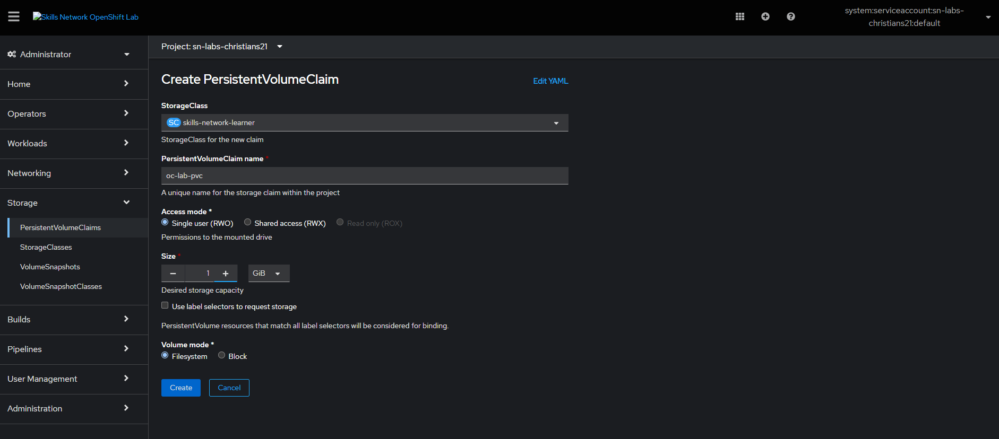
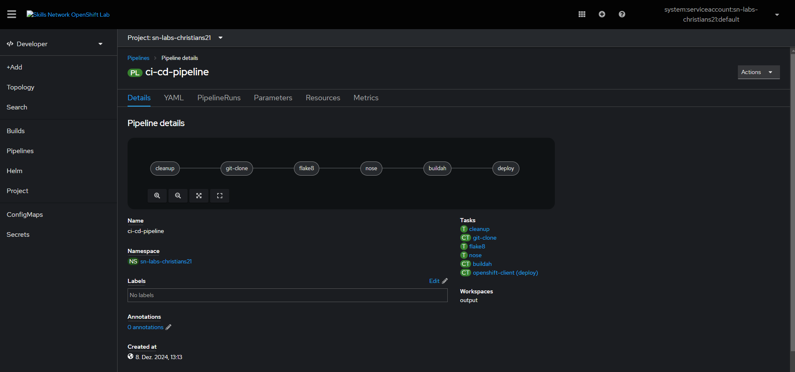
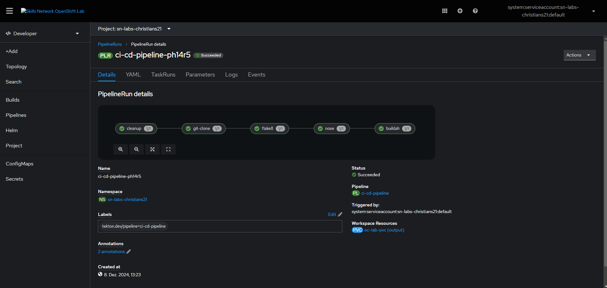
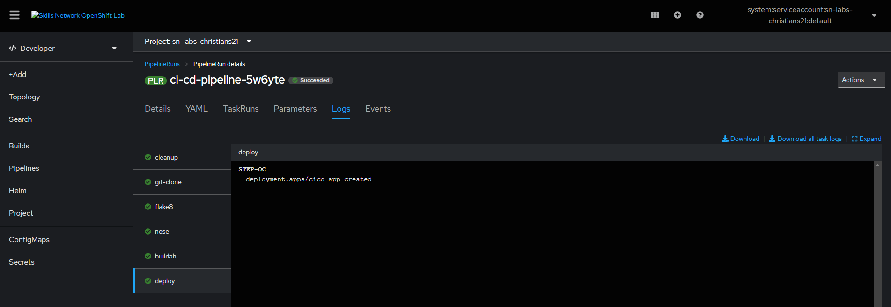
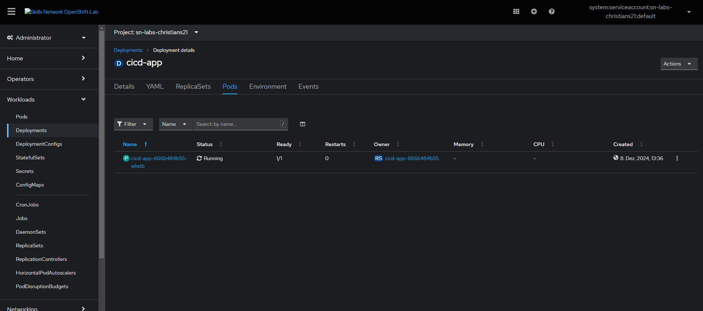

# Continuous Integration and Continuous Delivery (CI/CD) Pipeline

[](https://github.com/siddhipatil885/ibm-ci-cd/actions/workflows/workflow.yml)
[](LICENSE)
[](https://www.python.org/)
[](https://tekton.dev/)
[](https://www.redhat.com/en/technologies/cloud-computing/openshift)

---

## 📌 Project Overview

This repository contains the complete implementation of a **Continuous Integration and Continuous Delivery (CI/CD)** pipeline for a cloud-native Python microservice deployed to **Red Hat OpenShift Container Platform** using **Tekton Pipelines** and **GitHub Actions**.

The microservice provides a RESTful API for tracking and managing hit counters, containerized using Docker and Buildah, and automated through declarative GitOps pipelines.

### Author & Ownership Details
- **Student Name:** Siddhi Patil
- **GitHub Profile:** [@siddhipatil885](https://github.com/siddhipatil885)
- **Repository URL:** [https://github.com/siddhipatil885/ibm-ci-cd](https://github.com/siddhipatil885/ibm-ci-cd)
- **Course Provider:** IBM Developer Skills Network / Coursera
- **Course:** Continuous Integration and Continuous Delivery (CI/CD)

---

## 🛠️ Technology Stack

| Component | Technology | Description |
|---|---|---|
| **Language** | Python 3.9 | Application language |
| **Framework** | Flask & Gunicorn | REST API & WSGI HTTP Server |
| **Code Quality** | `flake8` | PEP 8 linting and syntax validation |
| **Testing** | `nosetests` | Automated unit testing and code coverage |
| **CI Automation** | GitHub Actions | Automated build, lint, and test on push/PR |
| **CD Automation** | Tekton Pipelines | Kubernetes-native CI/CD declarative pipeline |
| **Container Engine** | Buildah | Daemonless OCI container image builds |
| **Target Platform** | Red Hat OpenShift | Enterprise Kubernetes Container Platform |
| **Storage** | Kubernetes PVC | `skills-network-learner` storage class (1Gi) |

---

## 📋 Deliverables & Verification Checklist

| Question | Requirement | Deliverable / Evidence Link | Status |
|---|---|---|---|
| **Q1** | **Repository & README** | [README.md](https://github.com/siddhipatil885/ibm-ci-cd/blob/main/README.md) | Verified |
| **Q2** | **GitHub Actions CI Workflow** | [.github/workflows/workflow.yml](https://github.com/siddhipatil885/ibm-ci-cd/blob/main/.github/workflows/workflow.yml) | Verified |
| **Q3** | **Tekton Custom Tasks** | [.tekton/tasks.yml](https://github.com/siddhipatil885/ibm-ci-cd/blob/main/.tekton/tasks.yml) | Verified |
| **Q4** | **Tekton Pipeline Definition** | [.tekton/pipeline.yml](https://github.com/siddhipatil885/ibm-ci-cd/blob/main/.tekton/pipeline.yml) | Verified |
| **Q5** | **Storage Allocation (PVC)** | [evidence/q5_pvc_bound.png](evidence/q5_pvc_bound.png) | Bound (1Gi) |
| **Q6** | **Pipeline Execution** | [evidence/q6_pipeline_graph.png](evidence/q6_pipeline_graph.png) | In Progress |
| **Q7** | **Pipeline Completion** | [evidence/q7_pipeline_succeeded.png](evidence/q7_pipeline_succeeded.png) | Succeeded (All Green) |
| **Q8** | **Application Runtime** | [evidence/oc-pipeline-application-logs](evidence/oc-pipeline-application-logs) | `SERVICERUNNING` on :8000 |

---

## 🏗️ Architecture & Pipeline Workflows

### 1. Continuous Integration (GitHub Actions)
Triggered on push or pull request to the `main` branch:
1. **Checkout:** Clones the repository code into the runner workspace.
2. **Install Dependencies:** Upgrades `pip` and installs requirements from `requirements.txt`.
3. **Lint with flake8:** Checks for syntax errors (`E9`, `F63`, `F7`, `F82`) and PEP 8 complexity limits.
4. **Run Unit Tests:** Executes `nosetests -v --with-spec --spec-color` covering all route endpoints.

### 2. Continuous Delivery (Tekton on OpenShift)
Orchestrates sequential tasks sharing the `pipeline-workspace`:

```text
[ cleanup ] ──► [ git-clone ] ──► [ flake8 ] ──► [ nose ] ──► [ buildah ] ──► [ openshift-client ]
```

1. **`cleanup`:** Wipes existing workspace artifacts to ensure clean builds.
2. **`git-clone`:** Clones the verified code revision into the shared workspace.
3. **`flake8`:** Validates code quality and standards in the cluster container environment.
4. **`nose`:** Runs complete automated unit test suite inside Python 3.9 runtime.
5. **`buildah`:** Builds container image directly in OpenShift without root Docker daemon.
6. **`openshift-client`:** Applies declarative deployment manifests and rolls out application pods.

---

## 🔌 RESTful Microservice API Endpoints

| Method | Endpoint | Description | Expected Status |
|---|---|---|---|
| `GET` | `/` | Root service metadata & hit counter summary | `200 OK` |
| `GET` | `/health` | Application health probe status | `200 OK` |
| `GET` | `/counters` | Lists all active counters | `200 OK` |
| `POST` | `/counters/<name>` | Creates a new counter initialized to `0` | `201 Created` |
| `GET` | `/counters/<name>` | Reads the current value of a counter | `200 OK` / `404 Not Found` |
| `PUT` | `/counters/<name>` | Increments counter value by `1` | `200 OK` / `404 Not Found` |
| `DELETE` | `/counters/<name>` | Deletes an existing counter | `204 No Content` |

---

## 🚀 OpenShift Execution Commands

### Apply Tekton Manifests & Persistent Volume Claim
```bash
oc apply -f .tekton/tasks.yml
oc apply -f .tekton/pipeline.yml
oc apply -f .tekton/pvc.yml
```

### Start the PipelineRun
```bash
tkn pipeline start cd-pipeline \
  -w name=pipeline-workspace,claimName=oc-pipelines-pvc \
  -p repo-url=https://github.com/siddhipatil885/ibm-ci-cd \
  -p branch=main \
  --showlog
```

### Verify Deployment & Runtime Logs
```bash
oc get pods -l app=service
oc logs deployment/service > oc-pipeline-application-logs
cat oc-pipeline-application-logs
```

---

## 📷 Evidence Gallery

### Q5: OpenShift PersistentVolumeClaim in Bound State


### Q6: Pipeline Execution Graph



### Q7: End-to-End Pipeline Succeeded (All Green)


### Q8: Application Deployment Pod


---

## 📄 License
Licensed under the [Apache License, Version 2.0](LICENSE).